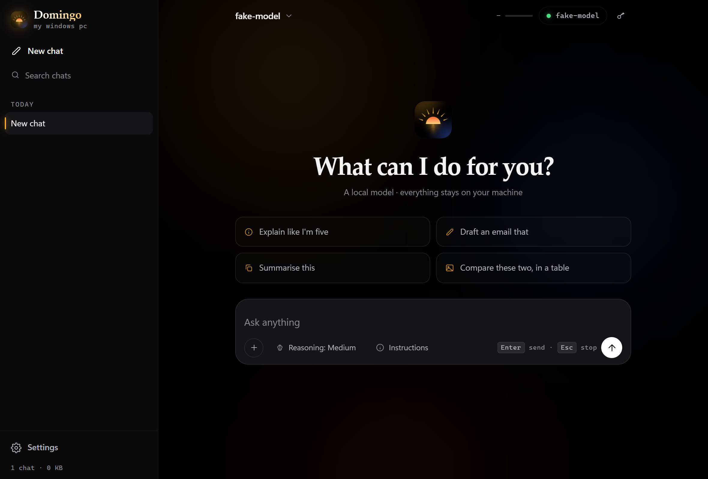
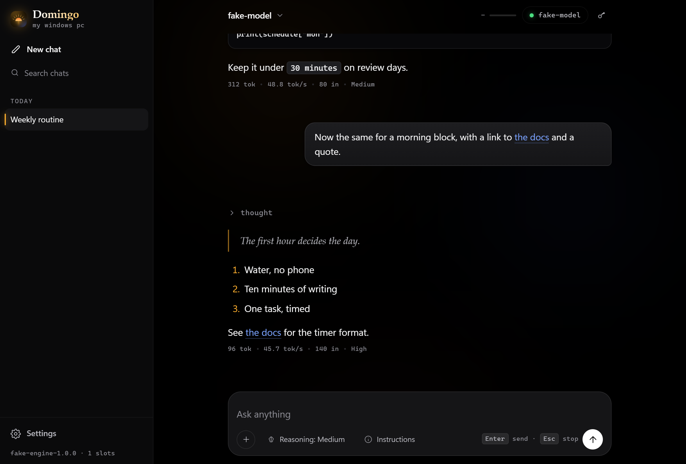
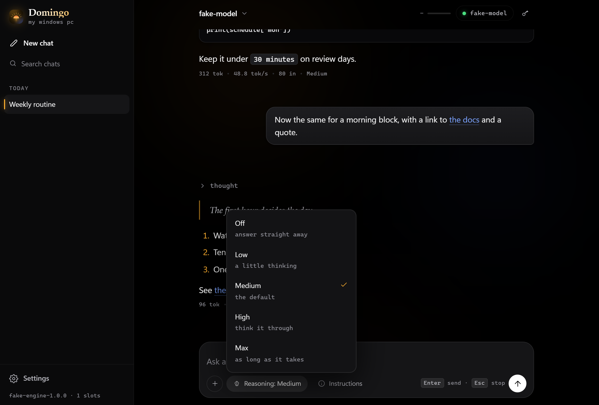
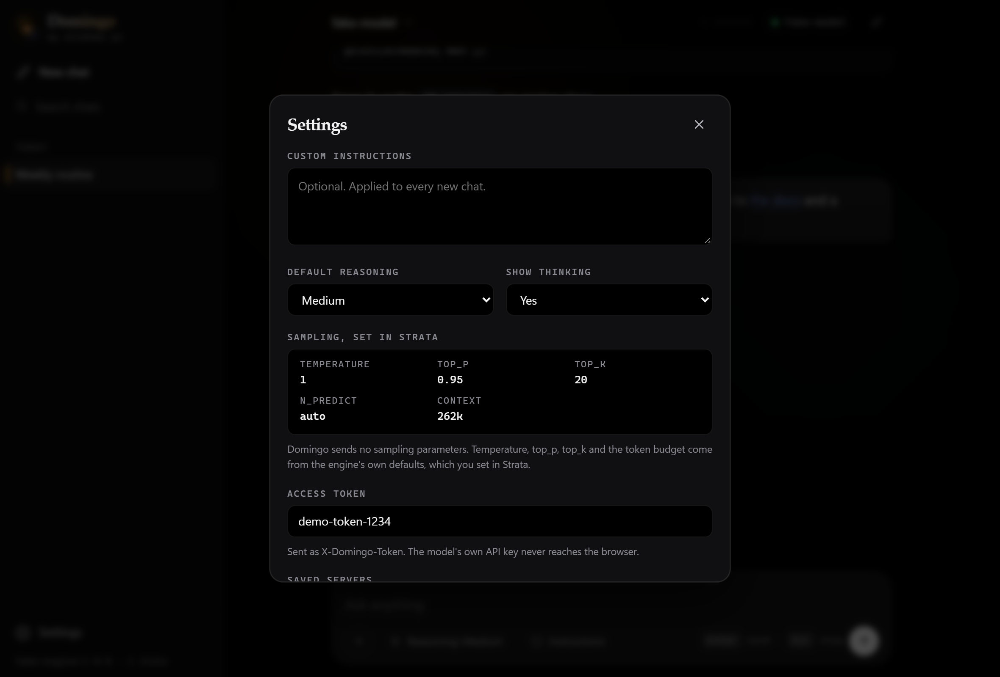
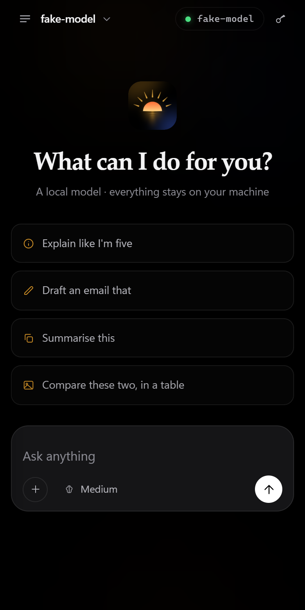
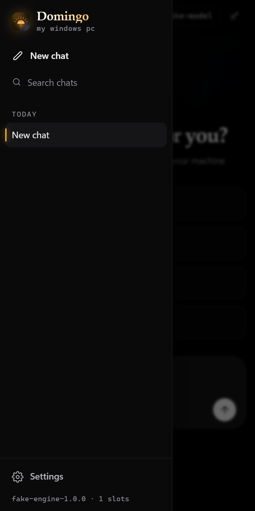

# Domingo

Domingo is a chat window for a model that runs on your own computer. Strata hosts
the model on my Windows PC, and I wanted to talk to it from my MacBook and my phone,
so I built this. It is a small server plus a single-page chat interface: the server
forwards your prompts to the model and streams the answers back, and the interface
looks like the chat apps you already know. Nothing goes to a cloud provider. The
model, the prompts and the key live on machines you own. It is free for personal
use, and the source is published.



## What you get

- A chat window that remembers your conversations, on the device you use.
- Streaming answers, so you read the reply as it is written.
- A thinking panel for models that reason before answering, shown and foldable.
- Images in, images out: paste a screenshot, drag a file in, ask about it.
- Markdown that renders, including code blocks with a copy button, tables and lists.
- One control per conversation, reasoning effort, set to Off, Low, Medium, High
  or Max.
- No sampling knobs. Temperature and its friends stay in the model server, where
  you set them once.
- Search across your chats, pin the ones you keep, rename them, export them.
- Install it as an app on your phone or desktop.
- A status pill that says whether the model is awake, busy, or unreachable.

A conversation with a table, a code block and a folded reasoning panel:



The reasoning control, with what each setting does:



## Installing it

Two machines are involved. The one that runs the model is the **server**. The one you
type into is the **device you chat from**. Steps 1 to 6 are on the server.

A terminal is a window where you type commands. On Windows, press the Windows key,
type `cmd`, press Enter. On macOS, press Command+Space, type `Terminal`, press Enter.

1. Install Python. Go to <https://www.python.org/downloads/windows/>, download the
   latest 3.x installer, run it, and on the first screen tick **Add python.exe to
   PATH**, then accept the defaults.
   Prove it: type `python --version` and press Enter. Expect `Python 3.12.x`. If
   Windows says the command is not found, close and reopen the terminal. If it is
   still not found, run the installer again and tick the PATH box.
2. Get the code. With git: `git clone https://github.com/iulianduminica/Domingo.git`.
   Without it: download the zip from the latest release and unzip it.
   Prove it: `cd Domingo` (`cd` means change folder), then `dir` on Windows, `ls`
   on macOS. Expect `domingo.py` and a folder called `static`.
3. Make your config. `copy domingo.example.json domingo.json` on Windows,
   `cp domingo.example.json domingo.json` elsewhere.
4. Put a token in it. Open `domingo.json` in Notepad and replace the `token` value
   with a secret you make up, at least 16 characters. This is the only thing between
   your model and the rest of your network.
5. Start it. `run.cmd` on Windows, `./run.sh` on macOS and Linux. Expect four lines:

   ```
   Domingo 0.2.0
     model    swift-1.5-iq3_s
     upstream http://127.0.0.1:18500  key set
     open     http://127.0.0.1:8899/?t=<your token>
   ```

   If it says `no Strata server found`, start Strata first, or put its address and
   key in `domingo.json` the way the example file shows.
6. Open it. Visit the address on the `open` line and start chatting.

To stop, press Ctrl+C in that window. To start the next day, run `run.cmd` again.
Steps 1 to 4 happen once and are not repeated.

Your conversations are stored by your browser, on the device you typed them into, in
localStorage and IndexedDB. The server keeps no database and writes no chat files.
Back them up from Settings, Export: one JSON file, images included. Import puts it
back on another machine.

Settings, with the defaults the model server published:



## Installing it with Docker

Docker runs the app in a self-contained box, so you do not install the runtime at all.

1. Install Docker Desktop from <https://www.docker.com/products/docker-desktop/>
   and start it once.
2. `cd Domingo`, then `docker compose up --build`.
3. Open `http://127.0.0.1:8899/?t=replace-me-with-a-long-secret`.
   Prove it: `docker compose ps` shows `healthy` after about half a minute.
4. Edit `docker-compose.yml` first. Set `DOMINGO_TOKEN` to a real secret, and set
   `DOMINGO_URL` to your model server. The default,
   `http://host.docker.internal:18500`, reaches a model bound to your host's
   loopback: on Docker Desktop that works out of the box, and on Linux the
   `extra_hosts` line in the file provides the name.
5. Stop with Ctrl+C, then `docker compose down`.

The container cannot read the config files your model server writes on the host, so
it needs `DOMINGO_URL` and `DOMINGO_KEY` handed to it. Discovery is the one thing the
plain `run.cmd` path does for you that Docker cannot.

## Connecting from another device

The server binds `127.0.0.1`, so only that machine can reach it. To chat from a
laptop you put something in front of it.

The way I use is Tailscale, a private network for your own devices.

1. Install Tailscale on the server and on the device, signed in to the same account.
2. On the server, `tailscale ip -4` prints its address, something like `100.64.0.0`.
   Its name is in `tailscale status`.
3. Serve it: `tailscale serve --bg --https=8443 localhost:8899`.
4. Open `https://<your-machine>.ts.net:8443/?t=<your token>` on the other device.
   The token in the URL is remembered, so a plain bookmark works after the first visit.
5. Add `advertise` to `domingo.json` with that address. The banner then prints a line
   saying the app is reachable beyond the machine, and Domingo refuses to advertise
   anything without a token.

On the same local network without Tailscale: `run.cmd --host 0.0.0.0 --token <token>`,
then open `http://<server ip>:8899`. Windows asks about the firewall; allow it on your
private network.

When it fails, in the order I have hit them: the server is not running
(`curl.exe -s http://127.0.0.1:8899/healthz` should print
`{"ok": true, "version": "0.2.0"}`), the firewall is blocking the port, the address
is a LAN address from a network you are not on, the device is on guest wifi that
blocks peer traffic, the token in the URL does not match `domingo.json`, or the model
is asleep and the status pill has gone red.

The same interface at phone width, and the conversation drawer open:





## How it works, briefly

The browser talks only to Domingo, never to the model. Domingo adds the model's API
key on the server side, so the key never reaches a device that is not yours. It also
solves CORS, because the model server sends no CORS headers and a browser would
otherwise refuse to talk to it directly. Answers arrive as a stream of small JSON
events, and the interface paints them as they land. History is written by your
browser, not by the server, which is why the server keeps no database and stays one
Python file. The same file can run on the machine that hosts the model, or on a
second machine as a thin proxy that reaches the first one across your network.

## For developers

Nothing has to be installed to run it. The app imports the standard library: 16
modules, no third-party ones.

    git clone https://github.com/iulianduminica/Domingo.git
    cd Domingo
    run.cmd                       # Windows
    ./run.sh                      # macOS, Linux

The test suites need Node and mypy, dev-only:

    pip install -r requirements-dev.txt
    npm install
    npx playwright install chromium
    python tools/ci-run.py

That last command starts a stand-in model server, points a real Domingo at it, and
runs 75 checks across five suites, on any machine, with no GPU. It is what CI runs.
The typecheck is `python -m mypy`, clean on 5 source files. The build step is
`python -m compileall -q domingo.py tools tests`, because there is no build.
`python tools/check-secrets.py` fails when a token, a tailnet hostname or a personal
path appears in a tracked file. The runtime is 253 KB across 7 files: `domingo.py`
at 728 lines and the interface at 1487.

`CONTRIBUTING.md` lists what is easy to break in this code, starting with why the
request handler is not called `handle`.

## A note on safety

Anyone with your token can use your model. They can send prompts, read answers,
spend your GPU time, and reach whatever the model itself can reach. If your engine
has file or tool access, the token is the key to that.

Out of the box nothing outside the server machine can connect, and Domingo refuses
to bind a shared address, or advertise one, without a token. Encryption comes from
whatever fronts the app, normally Tailscale: Domingo itself serves plain HTTP. The
hop from Domingo to the model is plain HTTP too, which is fine on loopback and not
fine across the internet. A token in a URL shows up in browser history, proxy logs
and screenshots, so use it once and bookmark the plain address.

There are no accounts, no per-device revocation and no rate limiting. Stop is
client-side: the model keeps generating. Do not expose this to the public internet,
do not commit your token, and do not share an engine that can read things you would
not want read by someone who guesses your token. `SECURITY.md` states the limits in
full.

## License

Free for personal, non-commercial use: you may run it, change it and share it, as
long as it is not sold and not offered as a paid hosted service. This is not an open
source license as the OSI defines one, so the honest description is source-published
software, free for personal use. The text is in [LICENSE](LICENSE).
